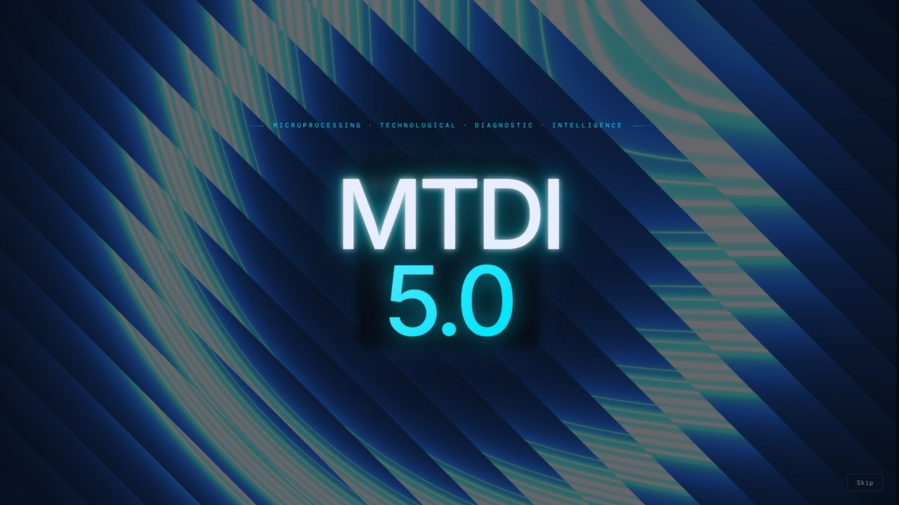
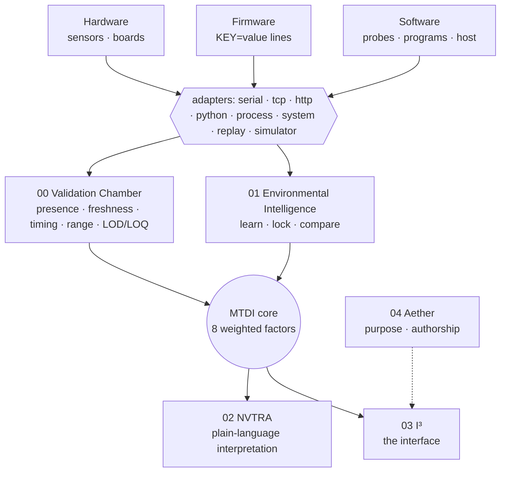
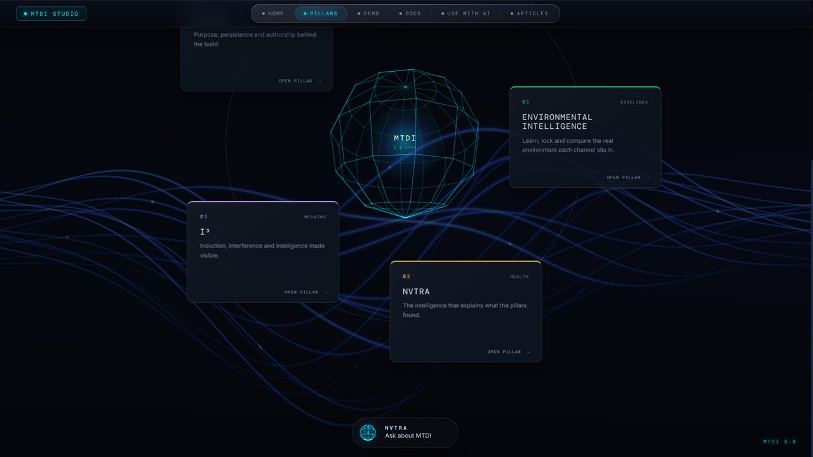
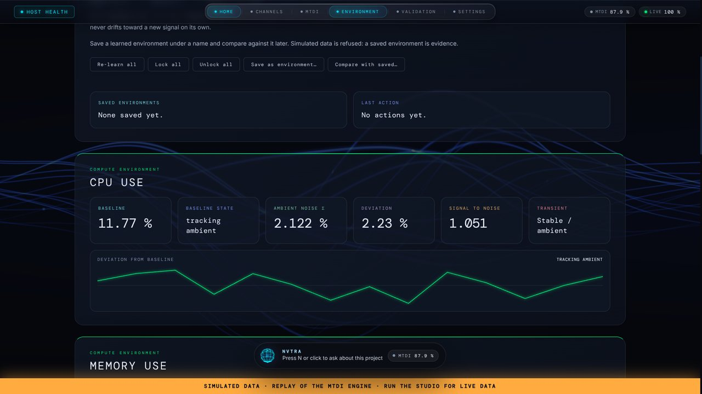
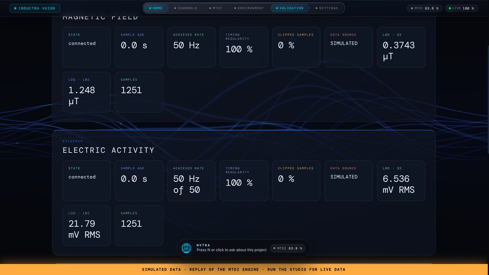

<div align="center">



# MTDI Studio · MTDI 5.0

**Microprocessing Technological Diagnostic Intelligence**

Turn anything that produces numbers (sensors, firmware, software, networks, security logs)
into channels. MTDI learns their normal environment, proves each one can be trusted, and
explains what it sees. Small enough for a Raspberry Pi.


[Use it from any AI](#use-mtdi-from-any-ai) · [Quick start](#quick-start) · [The pillars](#five-pillars-one-core) ·
[Projects](#every-field-one-framework) · [Docs](docs/AI.md) · [Articles](docs/articles)

</div>

---

## Use MTDI from any AI

Paste this into ChatGPT, Claude, Gemini or any coding assistant:

```text
Use MTDI 5.0 from https://github.com/vxnishhhhh/mtdi-studio- for my project. Read docs/AI.md in that
repository first and follow it step by step: read the listed files, run `python -m mtdi adopt` on my
repository, map my project to channels with me, write the manifest and any probes or firmware, then
verify with the commands in step 5 and tell me exactly what was and was not verified.
My project: <describe it>.
```

The repository is built to be read by machines as well as people: [`llms.txt`](llms.txt),
[`docs/AI.md`](docs/AI.md) (the procedure), [`AGENTS.md`](AGENTS.md) (the rules),
[`docs/schema/project.schema.json`](docs/schema/project.schema.json) (the manifest), and
`python -m mtdi describe` (every capability as JSON).

## What the name means

| | |
|---|---|
| **Microprocessing** | Runs where the data is: pure-Python engine, ~15 MB, comfortable on a Raspberry Pi or any small single-board computer |
| **Technological** | Any field: hardware, firmware, software, computers, networks, cybersecurity |
| **Diagnostic** | Captures readings *and* the evidence about them: presence, freshness, timing, range, noise, detection limits |
| **Intelligence** | NVTRA explains what the evidence shows; the system learns its own environment |

## Five pillars, one core



| | Pillar | What it does |
|---|---|---|
| 00 | **Validation Chamber** | Proves each channel is present, fresh, on time and inside its declared range. Detection limits come from measured noise: LOD = 3σ, LOQ = 10σ. |
| 01 | **Environmental Intelligence** | Learns each channel's baseline from the real environment with a time-windowed median that refuses excursions. Lock it, save it under a name, compare against it later. Simulated data can never be saved. |
| 02 | **NVTRA** | Universal interpretation rules plus each project's own domain rules (written as data). Every explanation says what a pattern suggests *and* what else could cause it. Answers questions from the live packet only. |
| 03 | **I³** | Induction · Interference · Intelligence. The interface, generated from the manifest: intro, glass header, scroll openings, orbits, full-screen pillars, live traces. The same components render the website. |
| 04 | **Aether** | Purpose, persistence and authorship. Non-functional: shown, never scored. |
| ◎ | **Core** | Eight named, weighted factors per channel (availability, baseline, signal to noise, clipping, timing, transient, axial consensus, correlation). An evidence-quality score you can take apart; **not a probability**. |

<table>
<tr>
<td></td>
<td></td>
</tr>
<tr>
<td></td>
<td></td>
</tr>
<tr>
<td></td>
<td></td>
</tr>
</table>

## Quick start

```bash
git clone https://github.com/vxnishhhhh/mtdi-studio- && cd mtdi-studio-
pip install -r requirements.txt

python -m mtdi run projects/host-health                 # real data from the computer you are on
python -m mtdi run projects/inductra-vaion --simulate   # an instrument, no hardware needed
python -m mtdi watch projects/host-health               # the same, in a terminal (works over SSH)
python -m unittest discover tests                       # 29 tests
```

Open http://127.0.0.1:8050.

## Every field, one framework

| Project | Field | Source | Shows |
|---|---|---|---|
| [`inductra-vaion`](projects/inductra-vaion) | Electromagnetic instrument | Arduino firmware over USB or TCP | Project 1. Its firmware runs unchanged (byte-identical, test-guarded) |
| [`ultrasonic-room`](projects/ultrasonic-room) | Acoustic ranging | HC-SR04 firmware | A non-electromagnetic sensor on the same pillars |
| [`host-health`](projects/host-health) | Computers / single-board computers | `system` adapter, no wiring | Real data from the machine MTDI runs on |
| [`network-watch`](projects/network-watch) | Networking | A plain-Python probe via `process` | Any program that prints numbers is a source |
| [`auth-watch`](projects/auth-watch) | Cybersecurity | Auth-log probe via `process` | Learns a host's normal login rhythm; describes brute-force patterns |
| AstroTech | — | — | Next project, not started |

A new project is one manifest: `python -m mtdi new <id>` here, or `python -m mtdi adopt <repo>`
to build another repository on MTDI from its first commit.

## Start a project with everything around it

```bash
python -m mtdi create
```

The wizard asks for a name and description, then optionally:

| | Needs | Does |
|---|---|---|
| **GitHub** | `gh` signed in, or `GITHUB_TOKEN` | creates the repository and pushes |
| **Vercel** | `VERCEL_TOKEN` (+ `VERCEL_TEAM_ID`) | deploys the project's studio under the name you choose |
| **Notion** | `NOTION_TOKEN`, `NOTION_PARENT_PAGE_ID` | creates a project page: channels, pillars, links |
| **MATLAB** | your browser's MathWorks sign-in | writes a starter script and opens MATLAB Online (or desktop MATLAB with `--local`) |

Tokens are read from the environment only and never written anywhere; a test checks it.
Preview with `--dry-run`. See [`.env.example`](.env.example).

## Two implementations

[`matlab/+mtdi`](matlab) is an independent MATLAB implementation. `mtdi.verify` checks that
it agrees with `python -m mtdi analyze` on the same recording, field for field. The test
suite runs this check in GNU Octave. It has not yet been run in MATLAB itself.

## Command line

| Command | |
|---|---|
| `run <project> [--simulate] [--headless] [--record f.jsonl]` | start the studio (interface, or JSON API only) |
| `watch <project>` | live terminal view |
| `check <project>` | validate a manifest and print the channel map |
| `new <id>` · `adopt <repo>` · `create` | start a project here, in another repository, or with the wizard |
| `publish vercel\|notion\|matlab <project>` | one integration on its own |
| `analyze <project> <recording>` | batch summary (MATLAB's `mtdi.analyze` must match it) |
| `packet <project>` · `parse "<line>"` · `describe` | inspect a packet, test a firmware line, list capabilities |
| `site build` | build the website from the repository |

## Honest about

* The score is a heuristic evidence-quality score, **not a calibrated probability**.
* Simulated data is labelled at every layer, never recorded, never saved as an environment.
* The firmware templates and the ultrasonic sketch have not been run on hardware in this
  repository. Inductra's firmware has, in Inductra.
* Engine cost was measured on a 2.1 GHz Xeon (≈25 µs per line). The Raspberry Pi figures in
  the articles are estimates, not measurements.
* The GitHub, Vercel and Notion integrations are tested against faithful fakes of their APIs,
  not against the live services.

## Repository

```
mtdi/                 the framework (engine, core, pillars, adapters, studio, site, integrations)
  pillars/            00 validation · 01 environment · 02 nvtra · 03 i3 · 04 aether
projects/             one folder per project, plus _template
firmware/             PROTOCOL.md and firmware templates (Arduino, MicroPython)
matlab/+mtdi/         the independent MATLAB toolbox
docs/                 AI playbook, manifest reference and schema, articles
site/                 website assets (python -m mtdi site build → site/dist)
tests/                29 tests, standard library only
```

## Origin

Created by **Vaishnav**. MTDI began inside [Inductra Vaion](projects/inductra-vaion), a
Raspberry Pi instrument that measures the electromagnetic environment, where it was the
layer that decided whether a measurement could be believed. Inductra Vaion remains its own
repository. MTDI 5.0 is that layer made universal.

Released under the [MIT License](LICENSE).
